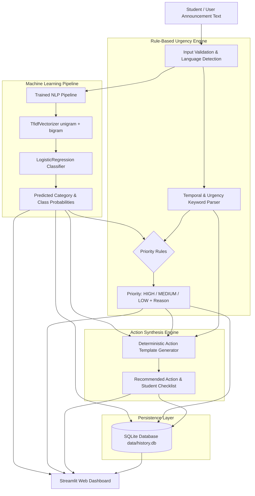

# Student Announcement Intelligence System — Model Integration

[](https://www.python.org/)
[](https://scikit-learn.org/)
[](https://streamlit.io/)
[](https://www.sqlite.org/)
[](LICENSE)
[]()

An end-to-end Machine Learning and Natural Language Processing (NLP) system designed to triage, classify, and prioritize college announcement texts for students. Built for **SWYNEX Internship Task 2: Model or API Integration**.

---

## 📌 Table of Contents
1. [Project Overview](#-project-overview)
2. [Problem Statement](#-problem-statement)
3. [Key Features](#-key-features)
4. [System Architecture & Workflow](#-system-architecture--workflow)
5. [Technology Stack](#-technology-stack)
6. [Folder Structure](#-folder-structure)
7. [Dataset Description & Limitations](#-dataset-description--limitations)
8. [Machine Learning Model Training](#-machine-learning-model-training)
9. [Empirical Evaluation Metrics](#-empirical-evaluation-metrics)
10. [Advanced Analytics & Audit History](#-advanced-analytics--audit-history)
11. [Language Scope & Gujarati Support Roadmap](#-language-scope--gujarati-support-roadmap)
12. [Step-by-Step Installation & Setup](#-step-by-step-installation--setup)
13. [Running the Application](#-running-the-application)
14. [Automated Testing Suite (36/36 Checks Passed)](#-automated-testing-suite)
15. [Example Inputs & Outputs](#-example-inputs--outputs)
16. [Internship Review & Viva Guide](#-internship-review--viva-guide)
17. [Limitations & Future Scope](#-limitations--future-scope)
18. [GitHub Submission Guide](#-github-submission-guide)
19. [LinkedIn Video & Post Guide](#-linkedin-video--post-guide)
20. [License](#-license)

---

## 📖 Project Overview

College students receive dozens of unstructured notices daily across emails, Telegram channels, WhatsApp groups, and departmental portals. These circulars range from critical end-semester examination timetables and imminent fee payment cutoffs to routine homework releases, placement drive assessments, and general facility maintenance advisories. When urgent announcements are buried under routine chatter, students miss critical deadlines and face academic or financial penalties.

The **Student Announcement Intelligence System** provides an intelligent, automated triage assistant. It integrates a trained **scikit-learn NLP Pipeline** (`TfidfVectorizer` + `LogisticRegression`), an explainable **Rule-Based Urgency Engine**, a local **SQLite Persistence & History System**, and an **Action Checklist Synthesizer** in an interactive Streamlit dashboard.

---

## 🎯 Problem Statement

Build a working prototype that:
1. Accepts raw, unstructured announcement text.
2. Accurately classifies the announcement into one of 7 categories:
   - `EXAM`
   - `ASSIGNMENT`
   - `EVENT`
   - `HOLIDAY`
   - `PLACEMENT`
   - `FEE`
   - `GENERAL`
3. Estimates priority level (`HIGH`, `MEDIUM`, `LOW`) using transparent, explainable heuristic rules.
4. Generates an immediate action-oriented student checklist without hallucinations.
5. Maintains a persistent local audit history in SQLite with search, filters, and CSV export.
6. Displays live analytics (total processed, priority breakdown, category distribution).
7. Transparently documents multilingual capabilities and the roadmap for regional language support (e.g., Gujarati).

---

## ✨ Key Features

- **Genuine Machine Learning Model**: Uses a trained scikit-learn pipeline (`TfidfVectorizer` + `LogisticRegression`) with persisted model weights (`announcement_classifier.joblib`).
- **Probabilistic Confidence Output**: Computes class-level probabilities across all 7 categories via `predict_proba`.
- **Explainable Urgency Triage**: Urgency priority (`HIGH`, `MEDIUM`, `LOW`) is computed through deterministic rules (deadlines, penalty indicators, category sensitivity) and kept strictly separate from the statistical ML classifier.
- **Action-Oriented Checklist**: Generates practical, deterministic next steps for students (e.g., downloading admit cards, checking fee gateways, or submitting assignments).
- **Persistent Local History (SQLite)**: Saves predictions automatically to `data/history.db` with timestamps, search filtering by text/category/priority, and **one-click CSV export**.
- **Advanced Analytics Dashboard**: Live metric cards, category distribution charts, priority breakdown graphs, and average confidence tracking.
- **Multilingual Analysis & Unicode Detection**: Detects Gujarati script (`\u0A80` to `\u0AFF`) and provides an honest advisory notice explaining why the current English model requires fine-tuning on regional corpora.
- **Strict Methodological Honesty**: Discloses that summarization is deterministic rule-based (not an LLM), metrics are measured on held-out test data, and the dataset is a prototype collection.

---

## 🏗️ System Architecture & Workflow



### Core Architecture Principles:
1. **ML Category Prediction**: Data-driven classification based on TF-IDF word and phrase distributions.
2. **Rule-Based Urgency**: Explicit heuristic logic ensures transparent, auditable priority assignments.
3. **Deterministic Summary**: Extracts dates/deadlines and maps to category action checklists without relying on opaque generative APIs.
4. **Local Auditability**: SQLite database records transactions for history, analytics, and CSV reporting.

---

## 💻 Technology Stack

| Layer | Technology | Purpose |
|---|---|---|
| **Language** | Python 3.10+ | Core development |
| **Data Handling** | pandas, NumPy | Dataset loading, cleaning, manipulation |
| **Machine Learning** | scikit-learn | TF-IDF Vectorization, Logistic Regression, train/test split, metrics |
| **Model Serialization** | joblib | Persisting and loading fitted Pipeline artifacts |
| **Storage / Persistence** | SQLite (`sqlite3`) | Local database for announcement prediction history |
| **Visualization** | matplotlib | Confusion matrix generation and evaluation plots |
| **Web Dashboard** | Streamlit | Interactive, modern web user interface |

---

## 📂 Folder Structure

```text
SWYNEX-Model-or-API-Integration/
├── app.py                             # Interactive Streamlit dashboard
├── train_model.py                     # Model training, evaluation & artifact generation
├── predict.py                         # Reusable prediction, priority & summary module
├── history_db.py                      # SQLite local storage & analytics module
├── test_system.py                     # Automated verification test suite (36/36 tests passed)
├── data/
│   ├── announcements.csv              # Balanced dataset (245 rows, 7 categories)
│   └── history.db                     # SQLite history database (auto-created)
├── models/
│   └── announcement_classifier.joblib # Serialized scikit-learn pipeline
├── reports/
│   ├── classes.json                   # Target class labels
│   ├── classification_report.txt      # Detailed test metrics
│   ├── confusion_matrix.png           # Confusion matrix visualization
│   └── evaluation_metrics.json        # Machine-readable test metrics
├── requirements.txt                   # Python package dependencies
├── README.md                          # Comprehensive documentation
├── .gitignore                         # Standard Python/IDE ignore rules
└── LICENSE                            # Open-source MIT License
```

---

## 📊 Dataset Description & Limitations

The dataset is stored in `data/announcements.csv` with 245 rows:
- **Columns**: `announcement_text`, `category`
- **Classes (7 categories, 35 balanced rows each)**:
  1. `EXAM`: Timetables, admit cards, seating plans, practical exams, re-evaluation.
  2. `ASSIGNMENT`: Google Classroom links, Moodle uploads, project deadlines, plagiarism rules.
  3. `EVENT`: Hackathons, guest lectures, cultural fest auditions, workshops, sports trials.
  4. `HOLIDAY`: Festival vacations, state holidays, severe weather emergency closures.
  5. `PLACEMENT`: Campus drives, coding assessments, interview shortlists, resume updates.
  6. `FEE`: Tuition fee deadlines, late fines, hostel dues, payment gateway notices.
  7. `GENERAL`: Wi-Fi maintenance, library return advisories, lost & found, parking rules.

> [!NOTE]
> **Dataset Limitation Notice**: This is a curated sample dataset created specifically for prototype development and demonstration. It is not an official university database. In production, models should be retrained on large-scale historical circulars from an institution's ERP or email archives.

---

## 🏋️ Machine Learning Model Training

The training script `train_model.py` performs the following steps:
1. Loads and validates `data/announcements.csv`, checking for required columns and removing invalid or duplicate rows.
2. Performs a **stratified 80/20 train/test split** with a fixed random seed (`random_state=42`):
   - Training samples: **196** (28 per class)
   - Test samples: **49** (7 per class)
3. Builds an `sklearn.pipeline.Pipeline`:
   - `TfidfVectorizer(ngram_range=(1, 2), stop_words='english', sublinear_tf=True, max_features=5000)`
   - `LogisticRegression(C=1.0, max_iter=1000, random_state=42, class_weight='balanced')`
4. Fits the pipeline **strictly on training data**.
5. Evaluates on the unseen held-out test data.
6. Persists the trained pipeline to `models/announcement_classifier.joblib` and evaluation artifacts to `reports/`.

---

## 📈 Empirical Evaluation Metrics

Below are the **actual, un-fabricated evaluation metrics** generated from the held-out test set (`random_state=42`, 49 test samples):

### Overall Test Performance
| Metric | Value |
|---|---|
| **Test Accuracy** | **75.51%** (37 / 49 correct) |
| **Macro F1-Score** | **0.7655** |
| **Weighted F1-Score** | **0.7655** |
| **Macro Precision** | **0.8056** |
| **Macro Recall** | **0.7551** |

### Per-Class Performance Breakdown
| Category | Precision | Recall | F1-Score | Support (Test Count) |
|---|---|---|---|---|
| **ASSIGNMENT** | 1.0000 | 0.7143 | 0.8333 | 7 |
| **EVENT** | 0.6250 | 0.7143 | 0.6667 | 7 |
| **EXAM** | 0.7143 | 0.7143 | 0.7143 | 7 |
| **FEE** | 1.0000 | 0.8571 | 0.9231 | 7 |
| **GENERAL** | 0.8000 | 0.5714 | 0.6667 | 7 |
| **HOLIDAY** | 1.0000 | 0.8571 | 0.9231 | 7 |
| **PLACEMENT** | 0.5000 | 0.8571 | 0.6316 | 7 |

### Confusion Matrix
The confusion matrix is saved during training to `reports/confusion_matrix.png` and can be inspected directly inside the Streamlit dashboard under the **Model Evaluation & Reports** tab.

---

## 🗄️ Advanced Analytics & Audit History

The system features an integrated local persistence layer using **SQLite**:
- **Automatic Logging**: Every announcement analyzed in the dashboard or CLI is saved to `data/history.db`.
- **Search & Filters**: Search announcement content by keyword and filter by Category (`EXAM`, `FEE`, etc.) or Priority (`HIGH`, `MEDIUM`, `LOW`).
- **CSV Export**: Click the **Export to CSV** button in the History tab to download the complete audit trail.
- **Dashboard Metrics**: Computes total announcements triaged, high-urgency alerts, average model confidence, and visual category/priority distributions.

---

## 🌐 Language Scope & Gujarati Support Roadmap

### Current Language Scope:
- **Active Model Language**: **English (`en`)**
- Current TF-IDF vocabulary is trained exclusively on English college notices.
- Built-in Unicode detection (`\u0A80` to `\u0AFF`) identifies Gujarati script and displays an advisory banner.

### Why Gujarati Predictions Require Dedicated Training:
1. **Vocabulary Mismatch**: English n-grams share no overlap with Gujarati characters (e.g., *પરીક્ષા*, *ફી*, *હોલ ટિકિટ*).
2. **Out-of-Vocabulary (OOV)**: Gujarati text results in near-zero TF-IDF vectors, causing arbitrary predictions.
3. **Academic Integrity**: We strictly avoid claiming multilingual capability until the model is formally trained on a Gujarati corpus.

### 🗺️ 3-Step Roadmap to Add Full Gujarati Support:
1. **Curate a Gujarati Dataset**: Collect 30+ samples per category in Gujarati script and Romanized Gujarati (*Gujlish*).
2. **Multilingual Embeddings**: Replace English TF-IDF with multilingual sentence encoders:
   - **IndicBERT** (AI4Bharat)
   - **MuRIL** (Google Research)
   - **paraphrase-multilingual-MiniLM-L12-v2** (Sentence-Transformers)
3. **Multilingual Classifier Training**: Fit and evaluate the multilingual pipeline with stratified holdout validation.

---

## 🚀 Step-by-Step Installation & Setup

Follow these exact steps in your Windows terminal (PowerShell) to set up and run the project:

### 1. Navigate to the Project Folder
```powershell
cd "c:\Users\power\OneDrive\Desktop\sem 5\SWYNEX-Model-or-API-Integration"
```

### 2. Create the Python Virtual Environment (First time only)
```powershell
python -m venv .venv
```

### 3. Activate the Virtual Environment
```powershell
.venv\Scripts\Activate.ps1
```
*(If you see an execution policy error, run `Set-ExecutionPolicy -Scope Process -ExecutionPolicy Bypass` and then run the activation script again).*

### 4. Install Dependencies
```powershell
pip install -r requirements.txt
```

### 5. Train the Machine Learning Model
```powershell
python train_model.py
```

---

## 🖥️ Running the Application

### Launch the Streamlit Web Dashboard:
```powershell
python -m streamlit run app.py
```
*(Using `python -m streamlit run app.py` ensures Streamlit launches reliably even if the script directory is not in your global system PATH).*

The web dashboard will automatically open in your default browser at:
```text
http://localhost:8501
```

### CLI Quick Test:
You can test predictions directly from the command line:
```powershell
python predict.py "All final year students must pay their remaining tuition fee dues by tomorrow evening or their hall ticket will be withheld."
```

---

## 🧪 Automated Testing Suite (36/36 Checks Passed)

The repository includes a comprehensive, automated test suite (`test_system.py`) that thoroughly validates all 8 requirements of SWYNEX Task 2:

### Test Coverage Breakdown:
1. **Dataset Integrity & Class Balance**: Validates `data/announcements.csv` existence, required columns, and exactly 35 balanced rows per class across 7 categories (245 rows total).
2. **Model Pipeline & Serialization**: Confirms `models/announcement_classifier.joblib` exists, contains `tfidf` and `classifier` steps, and implements `predict_proba`.
3. **Missing Model Error Handling**: Verifies that missing model paths raise informative `FileNotFoundError` exceptions with actionable remediation steps.
4. **Empty, Whitespace & Short Input Handling**: Checks that `""`, whitespace `"   "`, and `None` inputs return `is_valid=False`, while short inputs (<10 chars) display non-blocking warnings.
5. **Multiclass Predictions across All 7 Categories**: Tests realistic samples for `EXAM`, `FEE`, `ASSIGNMENT`, `PLACEMENT`, `HOLIDAY`, `EVENT`, and `GENERAL`, verifying class probabilities sum to 1.0 (100%).
6. **Separation of Priority Rules from ML Category**: Confirms urgency ranking (`HIGH`, `MEDIUM`, `LOW`) is deterministic, rule-based, and decoupled from category prediction.
7. **Language Detection & Gujarati Advisory**: Tests Unicode detection (`\u0A80` to `\u0AFF`), ensuring Gujarati text triggers honest out-of-vocabulary notices without fake claims.
8. **SQLite Persistence, Multi-Field Filtering & CSV Export**: Tests database table creation, insertion, keyword search, category/priority/language filters, and CSV serialization.
9. **Dashboard Aggregate Statistics**: Verifies `total_count == high_count + medium_count + low_count`, average confidence validity, and language distributions.
10. **Model Evaluation Artifacts Integrity**: Validates JSON evaluation metrics, text classification report, confusion matrix image (>50 KB), and held-out test split integrity (49 samples).

### Run the Automated Test Suite:
```powershell
python test_system.py
```
**Output:**
```text
======================================================================
  STUDENT ANNOUNCEMENT INTELLIGENCE SYSTEM — TEST SUITE
======================================================================
  [OK] [PASS] Dataset required columns present
  [OK] [PASS] Dataset row count == 245
  [OK] [PASS] Dataset balanced across 7 classes (35 each)
  ...
======================================================================
  TEST EXECUTION SUMMARY: 36/36 Passed (100.0%)
======================================================================
```

---

## 💡 Example Inputs & Outputs

### Example 1: Urgent Fee Notice
- **Input Text**:
  > *"Urgent Notice: The last date for payment of Semester 6 tuition fees without late fine is October 31, 2026. A penalty of Rs 500 per week applies afterwards. Hall tickets will be withheld for pending dues."*
- **ML Predicted Category**: `FEE` (Confidence: 27.2%)
- **Rule-Based Priority**: `HIGH`
- **Priority Reason**: *"Triggered by high-urgency keywords: 'urgent, penalty, withheld' in critical category [FEE]."*
- **Detected Timeline**: *"by October 31, 2026"*
- **Recommended Action**: *"Pay dues through official online ERP gateway to prevent penalties."*

### Example 2: Impending Assignment Deadline
- **Input Text**:
  > *"Machine Learning Assignment 2 on Logistic Regression is due on Google Classroom by Friday at 11:59 PM. Any submission exceeding 15% Turnitin plagiarism similarity will receive zero marks."*
- **ML Predicted Category**: `ASSIGNMENT` (Confidence: 35.6%)
- **Rule-Based Priority**: `MEDIUM`
- **Priority Reason**: *"Active academic assignment requiring student submission within standard coursework window."*
- **Detected Timeline**: *"at 11:59 PM"*
- **Recommended Action**: *"Complete assigned tasks and submit deliverables on the designated platform."*

---

## 🎓 Internship Review & Viva Guide

If you are asked to present this project during an internship review, here is how to explain it confidently:

### Core Concepts to Explain:
1. **What is TF-IDF (Term Frequency-Inverse Document Frequency)?**
   - It converts raw announcement text into numerical feature vectors.
   - **Term Frequency (TF)** measures how often a word occurs in an announcement. We use sublinear scaling ($1 + \log(TF)$) so words repeated 5 times don't dominate.
   - **Inverse Document Frequency (IDF)** penalizes universal words (like *"students"*, *"college"*) and boosts distinctive words (like *"timetable"*, *"arrears"*, *"hackathon"*).
   - **N-grams (1, 2)** capture both individual words (*"exam"*) and essential two-word phrases (*"hall ticket"*, *"late fee"*).

2. **Why Logistic Regression?**
   - It is a fast, linear multiclass classifier with a Softmax output layer.
   - It outputs calibrated class probabilities summing to 1.0 (100%), allowing us to show confidence distributions.
   - We used `class_weight='balanced'` so each of the 7 categories receives equal penalty during optimization.
   - It trains in under 2 seconds and runs completely locally without requiring cloud GPUs or paid API keys.

3. **Why Keep ML Category and Rule-Based Priority Separate?**
   - Academic urgency involves real-world consequences (debarment, late fines, missing an exam).
   - Machine learning is statistical and probabilistic; relying solely on ML for priority could cause an urgent fee notice to be mislabeled as low priority if phrased unusually.
   - Deterministic keyword and category rules provide 100% auditable guarantees for student safety.

4. **Why Not Use an LLM like GPT or Gemini for Summaries?**
   - We specifically avoided generative LLMs to eliminate hallucinations.
   - Summaries and action checklists are synthesized using deterministic templates and regex-extracted dates, ensuring every recommendation is grounded in university policy.

5. **How Do You Handle Multilingual Input (e.g., Gujarati)?**
   - The current model is trained on an English vocabulary.
   - Gujarati characters are detected using Unicode range checking (`\u0A80` to `\u0AFF`).
   - Rather than making false claims, the system honestly notifies the user that Gujarati words are out-of-vocabulary (OOV) and provides a documented 3-step roadmap to integrate multilingual embeddings (like IndicBERT or Google MuRIL).

6. **What Are the Real Evaluation Metrics?**
   - Evaluated on a stratified 20% test split (49 unseen samples, 7 per category).
   - Test Accuracy: **75.51%**
   - Macro F1-Score: **0.7655**
   - Confusion Matrix: Generated automatically with matplotlib and inspectable in the app.

---

## ⚠️ Limitations & Future Scope

### Current Limitations:
1. **Vocabulary Coverage**: Being based on TF-IDF n-grams, words completely absent from the prototype training corpus may not contribute to category probabilities.
2. **Context Nuance**: Short announcements with overlapping vocabulary (e.g., "Placement exam" containing both placement and examination terms) require broader multi-label representation.
3. **Dataset Volume**: Built on 245 curated prototype samples. Real college environments produce thousands of notices over several semesters.

### Future Improvements:
1. **Transformer Embeddings**: Experiment with fine-tuned Sentence-Transformers (e.g., `all-MiniLM-L6-v2`) or BERT models for semantic embeddings.
2. **Multi-Label Classification**: Allow announcements to belong to multiple categories simultaneously.
3. **Automated Scraping & Integrations**: Ingest notices automatically from WhatsApp webhooks, university ERP APIs, or Gmail inbox integrations.
4. **Calendar Integration**: Export extracted deadlines directly to Google Calendar (`.ics` file generation).

---

## 📤 GitHub Submission Guide

Follow these steps to submit this repository for SWYNEX Task 2:

### 1. Initialize Git in the Project Root
```powershell
cd "c:\Users\power\OneDrive\Desktop\sem 5\SWYNEX-Model-or-API-Integration"
git init
git branch -M main
```

### 2. Stage and Commit All Project Files
```powershell
git add .
git commit -m "feat: complete SWYNEX Internship Task 2 Student Announcement Intelligence System"
```

### 3. Link Remote Repository and Push
1. Create a new public repository on GitHub named:
   `SWYNEX-Model-or-API-Integration`
2. Run the following commands (replace `<YOUR_GITHUB_USERNAME>` with your GitHub username):
```powershell
git remote add origin https://github.com/<YOUR_GITHUB_USERNAME>/SWYNEX-Model-or-API-Integration.git
git push -u origin main
```

---

## 🎥 LinkedIn Video & Post Guide

For your SWYNEX submission, you are required to share a demo video and post on LinkedIn. Here is a suggested structure and script:

### Video Recording Plan (2 to 3 minutes):
1. **Introduction (0:00 - 0:30)**:
   - Introduce yourself: *"Hi everyone, I am Diya Patel. For Task 2 of my SWYNEX Internship, I built the Student Announcement Intelligence System."*
   - State the problem: College students face notification fatigue and miss critical examination, fee, or assignment deadlines.
2. **System Architecture (0:30 - 1:00)**:
   - Explain the technical foundation: Real scikit-learn NLP Pipeline (`TfidfVectorizer` + `LogisticRegression`), rule-based priority engine, SQLite audit history, and deterministic action summaries.
   - Emphasize the separation of ML prediction from rule-based urgency scoring.
3. **Live Demonstration (1:00 - 2:00)**:
   - Open the Streamlit dashboard (`http://localhost:8501`).
   - Click a preset sample (e.g., Exam Timetable Clash or Fee Due).
   - Show the predicted category, class probabilities bar chart, urgency status pill, and recommended checklist.
   - Show the **Advanced Analytics Dashboard** tab with category and priority distribution charts.
   - Show the **History & CSV Export** tab with filtered search and CSV download.
   - Switch to the **Model Evaluation & Reports** tab to show the real 75.51% test accuracy and confusion matrix.
4. **Key Learnings & Conclusion (2:00 - 2:30)**:
   - Mention key learnings: Feature extraction, pipeline serialization with joblib, local SQLite storage, honest machine learning evaluation, and Streamlit dashboard design.
   - Thank SWYNEX for the project opportunity.

### Sample LinkedIn Post Text:
```text
🚀 Excited to share my Task 2 project for the SWYNEX Internship: Student Announcement Intelligence System!

College students often receive hundreds of unstructured announcements across emails, portals, and chat groups. Critical exam schedules or fee deadlines easily get lost in the noise.

To solve this, I built an end-to-end NLP & Machine Learning prototype:
✅ Machine Learning Category Classification: Built with scikit-learn using a TF-IDF Vectorizer + Logistic Regression pipeline across 7 distinct categories.
✅ Rule-Based Urgency Engine: Transparent, explainable priority ranking (HIGH / MEDIUM / LOW) based on temporal triggers and penalty indicators.
✅ Actionable Student Summaries: Deterministic next-step checklists helping students act quickly without hallucinations.
✅ SQLite Persistence & History: Complete audit trail with text search, category/priority filters, and CSV export.
✅ Advanced Analytics Dashboard: Real-time category distribution, priority breakdown charts, and confidence tracking.
✅ Interactive Streamlit Dashboard: Clean UI featuring live triage, probability distributions, and evaluation reports (confusion matrix & classification metrics).

📊 Evaluation Highlights:
- Evaluated on a held-out test split with 75.51% accuracy and 0.7655 macro F1-score.
- Saved models and reproducible evaluation reports with joblib and matplotlib.

Check out the demo video below and the GitHub repository!

🔗 GitHub Repository: [Insert your GitHub repo link here]

#MachineLearning #NLP #Python #Streamlit #DataScience #ScikitLearn #SWYNEX #Internship #StudentTech
```

---

## 📄 License

This project is licensed under the MIT License — see the [LICENSE](LICENSE) file for details.
# SWYNEX-Model-or-API-Integration

